  

### Hola, soy Ariel 👋

Estudio Ingeniería Mecatrónica en la Universidad Iberoamericana (CDMX). Me gusta construir donde se juntan el software y el mundo físico: realidad mixta, robots, sensores e inteligencia artificial.

- 🥽 Hago apps de **realidad mixta** en Unity para el **Meta Quest 3**.
- 🤖 Estoy construyendo **Jarvis**, un asistente de voz con Claude que carga, despieza y mueve robots en tu cuarto.
- 📡 Ahora le entro al **IoT** con MQTT y ESP32.

### Proyecto destacado

<table>
  <tr>
    <td width="52%">
      
    </td>
    <td>
      <h4><a href="https://youplay2233.github.io/tecnologias-emergentes/">Tecnologías Emergentes</a></h4>
      Prácticas de realidad mixta con Unity 2022.3 y el Meta Quest 3, cada una con su video, y el proyecto final, <b>Jarvis</b>: le hablas con el visor puesto, te contesta con voz y actúa sobre lo que ves.
        
      <a href="https://youplay2233.github.io/tecnologias-emergentes/">Ver la página</a> · <a href="https://github.com/youplay2233/tecnologias-emergentes">Ver el código</a>
    </td>
  </tr>
</table>

### Con qué trabajo

  
  
  
  
  
  
  
  
  
  

